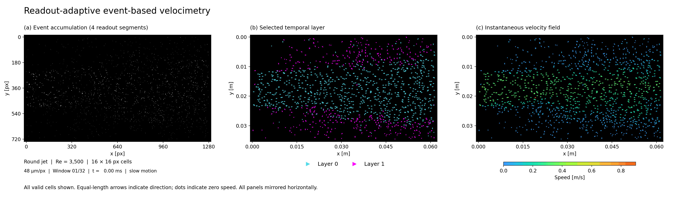

# Readout-adaptive event-based velocimetry (EBV)

Python code for reconstructing velocity fields from event-camera recordings under continuous illumination.

Code accompanying **Readout-adaptive event-based velocimetry under continuous illumination**, by **Dongmin Sun and Hyungmin Park**, Multiphase Flow & Flow Visualization Laboratory, Seoul National University.



*Round jet, Re = 3,500. (a) Events accumulated over 4 readout segments (axes in px). (b) Selected layer: cyan = Layer 0, magenta = Layer 1. (c) Velocity field colored by speed (m/s; axes in m). Equal-length arrows show direction. All valid cells are displayed; panels are mirrored horizontally and played in slow motion.*

## Installation

Download or clone this repository and run the commands below from its root folder. Tested with Python 3.9.13 on Windows 10; no GPU is required.

```bash
python -m pip install -r requirements.txt
```

For recordings in .raw or .hdf5 format recorded with Metavision SDK, also install the [Metavision SDK](https://docs.prophesee.ai/stable/installation/index.html) with compatible Python bindings (tested with SDK 4.6.2).

Sample recordings are not currently included.

## Run on your data

All settings are in [configuration.py](configuration.py), with presets for pipe, jet and cylinder-wake flows. Leave one `ACTIVE_FLOW` line uncommented. Adjust the ROI, spatial calibration, layer settings, cell size and stride for your recording, then run:

```bash
python main.py --input /path/to/recording.raw --output results/my_run --workers 4 --save-vectors
```

For an HDF5 recording converted with the Metavision SDK, use its `.hdf5` path with the same command.

The output folder contains velocity vectors, flow statistics, timestamps and the settings used. Omit `--save-vectors` if you only need statistics. Set `--workers` to choose the number of CPU workers.

See the [usage guide](docs/usage.md) for input formats, additional options and output units.

## License

[MIT License](LICENSE). The example GIF uses this project's own experimental data.
